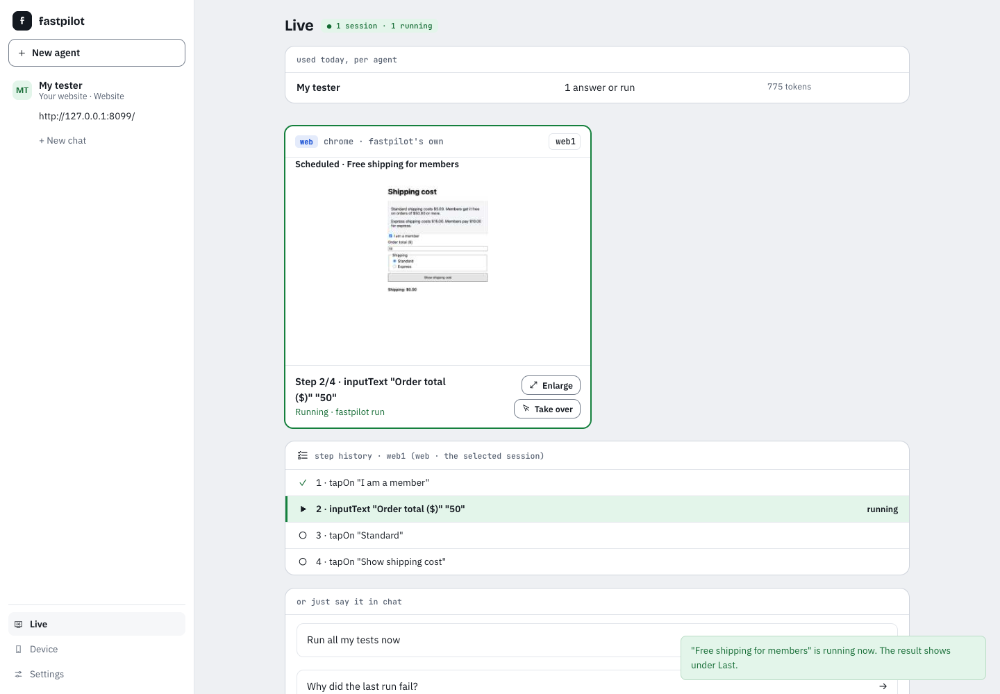
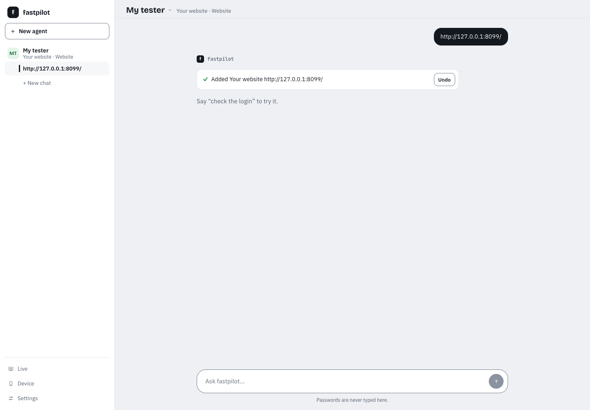

# fastpilot

**Test your web, Android, and iOS apps in plain language, from one dashboard.**
You say what to check; AI runs it on your own computer, shows you every step live, and tells you
what passed and what failed. Free, open source, no cloud. Payment and delete-account buttons are
blocked from the start.

New in 0.7.2: each agent can use its **own AI model**, **reports** of a run you can share, one-time
codes asked once while the test waits, and a **Live** and **About** tab on every agent. fastpilot is
now **MIT**-licensed. See the [release notes](https://github.com/autobot-lab/fastpilot/releases/tag/v0.7.2).


## Start in 2 steps

You need a Mac (or Linux), Google Chrome, and [Claude Code](https://claude.com/claude-code) signed in.
No project folder is needed: run it from anywhere.

**1. Install** (once)

```bash
npm install -g fastpilot
```

**2. Open the dashboard** (every time)

```bash
fastpilot
```

Your browser opens the dashboard. Keep the Terminal open while you use it; `Ctrl-C` closes it.

- The first screen is Chat. Paste your app's address (or say *"test my Android app"*) and fastpilot
  adds the app itself. An address that does not load is not added. Then say *"check the login"*.
- If the test needs a password, fastpilot asks for the test account right there, once, in a masked
  field, in that same answer. Click **Save and run**. It is kept in this Mac's Keychain for that app
  and typed only on that app's own website, never into Chat.
- Your tests, schedules and notes live in `~/fastpilot`. Each app has its own tester (agent), listed on
  the left.
- The first `fastpilot` also adds fastpilot to Claude Code for every folder, so Claude Code can run
  your tests too.
- Typed again while the dashboard runs, `fastpilot` opens the same dashboard with a fresh link.
  After an update it offers to restart an older dashboard (it asks first, and only stops its own).
- The link works **once**, for **10 minutes**. If it expired, type `fastpilot` again.
- On the first open the dashboard asks **Remember this browser?** Say yes, and a bookmark of the
  dashboard opens it again without a new link, even after `fastpilot ui` restarts (it keeps its
  port). It stays signed in for 30 days after its last use, at most 90 days, only on this Mac. See
  and forget remembered browsers in Settings › Security.
- The dashboard only works on this computer.
- Open it yourself; do not ask the AI to open it for you.

Everything else happens in the dashboard.

> Just want to look around first? Run `fastpilot demo` instead. It makes a demo folder with demo
> pages and example tests, and opens the dashboard on the agent **Demo shop**. Say *"run the demo
> tests"* in Chat: Pay is never pressed (it is blocked), and the answer ends with
> *All 3 demo tests passed.* and one row per test.

### Developer mode: tests next to your code (optional)

If you want the tests in your code repository (reviewed in pull requests, run by the GitHub Action),
set fastpilot up inside that repository:

```bash
cd ~/your-project
fastpilot init
```

`init` asks before each change; answer `y`. The dashboard then shows the repository as one more app.
For CI, a password can also come from the environment (`export DEMO_PASS=...`).

> Using the Claude Code plugin (the MCP server and its 24 skills in one step:
> `/plugin marketplace add autobot-lab/fastpilot`, then `/plugin install fastpilot@fastpilot`)? Use **either** the plugin **or** the registration fastpilot
> adds itself, not both: both together start two fastpilot servers. `fastpilot doctor` shows where
> it is registered.

## Guide: your first test in the dashboard

### 1. Check your devices: **Device**
Shows whether Chrome, Android, and iOS are ready, with a ✓ or the reason why not.
- **Install Chrome**, **Set up an emulator** and **Set up iPhone testing** are **Fix** buttons. Each
  asks you first and says what it will do. They work only from this page, never from Chat.
- **iPhone** testing needs a one-time setup with your Xcode (about 5 minutes).
- Only web? Chrome is enough.

### 2. AI model and passwords: **Settings**
- **AI model:** Claude Code is used by default, with your own sign-in and no API key. Under
  **Providers** you can add OpenAI, OpenRouter, Groq, Ollama (runs on this Mac, no key) or any
  OpenAI-compatible server (**Other**, with its address). fastpilot loads the list of models from the
  provider, and you can type a model id yourself. **Default models** are what new agents start with.
  An API key is kept in this Mac's key store, never shown again, and sent only to its own provider.
  We have tried Claude only: models from other providers are shown as "not tried with fastpilot yet",
  and we have not run real OpenAI, OpenRouter or Groq accounts. Page text from the tests goes to the
  provider you choose; with Ollama it stays on this Mac.
- **Passwords:** you are not asked to add names first. The first time a check needs a password, a
  masked field appears in the same answer in Chat: type it once and click **Save and run**.
  **Settings › Secrets** only lists the passwords your tests use (names only, never values), with
  **Replace** and **Remove**.
- **Limits & permissions:** one "You are protected" statement, example changes you can click (they go
  to Chat), and every limit under **Every limit**. See the next section, "Safe from the start".
- **Security** lists the browsers you chose to remember. **Integrations** has Jira (**Sign in with
  Atlassian**, Jira Cloud only), webhook and GitHub. A real Atlassian sign-in has not been tested by
  the maker yet ([setup](docs/guide.md#jira)).

### 3. Agents and skills
An agent is a tester for one app. **My tester** is there from the start. **Chat**, **Live** and
**About** are there at once; **Skills**, **Schedules**, **History**, **Memory**, **Map** and **Model**
show after your first saved test.
- **New agent** (top left) asks for a website address, or say *"test my Android app"*. Or describe the
  agent in one sentence in Chat and click **Create**.
- The **Skills** tab: **General QA** (8 skills) is always on. Specialist skills are switches, grouped by
  technique (equivalence partitions, boundary values, decision table, state transitions, pairwise),
  checklists (safe checkout, login and one-time code, forms, accessibility, mobile) and acceptance
  tests. Each switch acts at once, with Undo. **Back to General QA** turns them all off.
- Jira skills appear after you connect Jira.
- The **Model** tab: choose the AI for this agent, one for **Replay** (repeats steps that are already
  recorded, fast and cheap) and one for **Explore and repair** (a new test, or when a replay fails).
  Each is **Same as default** or a provider and model, and they can come from different providers. If a
  provider does not answer, the run stops with a plain message; nothing goes to another provider by
  itself.
- The **Live** tab shows only this agent's running tests. The **About** tab has its name, model,
  skills, **Stop all** and **Remove agent** (with Undo).

You can have several agents, for example "Checkout" on web and "Login" on Android. Each has its own
chats, schedules, history, memory and map.

### 4. Ask for a test: **Chat**
Write what you want in plain words:

| You want to | Type in Chat |
|---|---|
| Check something now | *Check that login on https://yourapp.com goes to the Dashboard* |
| Save a test | *Create a test for the checkout flow and save it* |
| Test a field properly | *Test the quantity field properly* (it picks the technique and shows what it covered) |
| Run everything | *Run a regression* (newly failing tests come first) |
| Before a release | *Is staging ready to ship?* (one verdict: SHIP, SHIP WITH FIXES, DO NOT SHIP) |
| Understand a failure | *Why did the checkout test fail?* |

If a step needs a one-time code (an SMS or email code), fastpilot asks for it in Chat while the test
waits, in a masked field. The code is used once and never saved, and it is typed only on the app's own
website. If nobody types it within 3 minutes, the test stops there, once, with one red line
(*Stopped at step N: no code was typed in 3 minutes…*); say *"run it again"* when you have the code.
A test that needs a one-time code cannot run by itself on a schedule, because nobody is there to type
it: it says *Could not run* (never a pass). Start it from the dashboard.

When a test is ready, a card shows its steps: **Save & schedule** or **Save test only**, or one of the
one-click schedules under them. A test is saved only when you click. The picture at the top of this
page shows such a card.

### 5. Watch it run: **Live**
Watch every test step by step, on web, Android, and iOS. **Take over** if you need to tap something
yourself, then hand it back to the AI. Several agents can run at the same time; a phone runs one
test at a time and the others wait their turn. Tests started by hand or by a schedule show up here too.



### 6. Run it automatically: **Schedules**
- **One click:** three buttons run all of the app's tests by themselves: **Every 2 hours (8–20)**,
  **Every night** (2:00) and **Before each release** (it runs when you ask Chat *"Can we release?"*).
  A button that is on says **On · Turn off**.
- **Run now** for any schedule. A schedule saved from the dashboard uses the app's saved passwords,
  on **Run now** and on its timer. A schedule you made for an app added in Chat before 0.7.2 may say it
  needs a password: save it again from the dashboard.
- **Release watch** is one switch: after a release, re-check every 10 minutes for 2 hours and only
  tell you about new problems. It ends by itself.
- **Other times** (New schedule): pick which tests and when (every day, on weekdays or weekly).
- When something fails you get a notification on this computer. Under **Other times** you can also
  add a webhook (a Slack-compatible URL) or a GitHub issue.
- Or just ask in Chat: *"run the checkout tests every 2 hours"*.


### 7. See results: **History** and **Memory**
- **History:** every run and every Chat conversation, with report, screenshots, and video. **Make a
  report** on a run (or ask Chat *"make a report of that run"*, or run `fastpilot report`) writes a
  web page that opens offline and a Markdown file, with every screenshot of a failed test and the last
  one of each passing test. fastpilot writes them itself, on this Mac, and nothing is uploaded. Passwords
  and card numbers in the text show as `***`, but the screenshots show the page as it was: look at
  them before you share. Open, Download and Copy Markdown are on the card. Delete
  one, several, or all, or let them be deleted after 7, 30 (the default), or 90 days. Removed apps,
  schedules, chats and agents are kept for 7 days under **Recently removed**, with **Restore**.
- **Memory:** how each test is doing (Reliable, Unstable, Failing, Set aside), plus **project notes**
  every agent reads, for example *"Staging is https://staging.yourapp.com"* or *"Login uses a code"*.

## Dashboard map

| Where | What it's for |
|---|---|
| **Chat** (agents and their chats, on the left) | Ask for anything (see "Control everything from Chat" below). **+ New chat** starts another chat |
| **Live** (tab) | The running tests of this agent |
| **Model** | The AI for this agent: Replay, and Explore and repair |
| **About** | Name, model, skills, **Stop all**, **Remove agent** |
| **Skills** | General QA (always on) and specialist switches |
| **Schedules** | One-click schedules, release watch, other times |
| **History** | Past runs and conversations, **Recently removed** |
| **Memory** | Test health and project notes |
| **Map** | Which screens of your app have a test |
| **Live** (bottom left) | Every running test, from all agents |
| **Device** | Chrome, Android, iOS readiness and Fix buttons |
| **Settings** | AI model (default models and providers), Limits & permissions, Secrets, Security (remembered browsers), Integrations |

## Safe from the start

- Buttons like **pay, buy, checkout, transfer, delete account** are always blocked.
- Plain **delete/remove** buttons must be confirmed first.
- The AI can make the rules stricter, never looser. To loosen one, **you** approve it: Chat shows a red
  card that quotes what you asked, and allowing **Pay** also needs you to type "Pay". Text on a tested
  page can never ask for a change.
- Actions start only from your own message. Text from a page or a ticket cannot start a change, a run
  or a card.
- Every change is kept in `~/.fastpilot/audit.jsonl`.

Want to test a checkout for real? Ask in Chat: *"Allow the Pay button for this project"*, or open
**Settings › Limits & permissions**.

These limits protect you from what a tested page tells the AI. They are not a lock against programs
on your own computer: anything that runs as you can edit `~/.fastpilot/config.toml`.

## Control everything from Chat

What a dashboard page does, you can also ask for in Chat (the dashboard's, or Claude Code's), or
type in a terminal. All three use the same apps, tests, schedules and passwords.

| What | In a terminal |
|---|---|
| Your apps | `fastpilot app list`, `app add https://your-site` (or `app add com.shop.app --android`), `app switch NAME`, `app remove NAME` |
| One-click schedules | `fastpilot schedule add` (every 2 hours, 8–20), `--nightly` or `--before-release`; `schedule pause ID`, `resume ID`, `remove ID` |
| Agents | `fastpilot agent skills "My tester" +safe-checkout` (General QA is always on), `agent stop NAME` (stops that agent's running chats), `agent model NAME --replay X --explore Y` (or `--default`) |
| AI providers | `fastpilot provider list`, `add openrouter` (the key is read hidden), `models`, `refresh`, `remove NAME` |
| Reports | `fastpilot report` (the newest run; `--open`, `--markdown`, `--list`) |
| Test passwords | `fastpilot secret set TEST_PASSWORD` (typed hidden, or piped in; never on the command line), `secret list`, `secret remove NAME` |

In Claude Code, just ask in your own words: *"add my app https://shop.example"*, *"run the login
test"*, *"schedule all tests every night"*, *"pause that schedule"*, *"map the app"*, *"can we
release?"*, *"make a checkout tester"*. fastpilot's tools `apps`, `tests`, `schedules`, `map`,
`ship_check`, `secrets`, `memory`, `history`, `reports`, `agents` and `providers` do it. No tool takes a
password's value or an API key: Claude tells you to set it in the dashboard or in a terminal.

In the dashboard Chat, what you ask for is done at once and shows as one line, such as
*Paused schedule “Every night” · its history is kept*, with **Undo** on it. Renaming an app and
changing an agent's model have **Undo** too, and typing *"undo"* undoes the newest line that has an
Undo button in that chat. Loosening a safety limit
still needs your click on its red card, and a password is still typed only in its masked field.



There is no setup form: paste your website's address in the dashboard Chat and it is added (an
address that does not load is not added), or say *"test my Android app"* and pick it from the apps
on the running emulator. A new address in an agent that already has an app makes a new agent.

The dashboard works like a chat app: the agents are on the left, each with its chats (**+ New chat**
starts another; several can work at once, up to your "tests at once" limit, and the next one waits
for a free slot). **Stop** ends an answer and makes nothing it was about to make. Removing a chat
keeps it 7 days, with Undo.

Every change can be undone: the terminal prints `Undo: fastpilot undo <id>`, and `fastpilot undo --list`
shows what you can undo. Removing an app or a schedule keeps it 7 days (History › Recently removed,
with Restore). A password is kept for its app in this Mac's Keychain
and typed only on that app's own website, wherever you set it from.

A few things to say in Chat:

- *"remove my app"* removes the app of the chat you are in, kept 7 days, with Undo.
- *"rename this app to Shop (test)"* renames the app of the chat you are in, with Undo.
- *"use Haiku for replay and Sonnet for explore"* sets this agent's models (with Undo). A provider has
  to be connected first, in Settings › AI model.
- *"make a report of the last run"* makes the report described under History.
- *"stop tests after 5 minutes"* sets the time limit per test in minutes (built in: 30). A shorter time
  applies at once, with Undo. A longer one is a looser limit and needs the red card.
- To stop everything an agent is running, click the agent's name at the top, then **Stop all** under
  **Running now**. It stops every running chat of that agent, including the Claude Code and browsers
  they started, and leaves other agents running. It shows only while something runs.

## Prefer the terminal?

Everything also works from Claude Code. Open Claude in any folder (`claude`) and say it in
plain words, for example *"fastpilot, run a regression"* or *"fastpilot, test the login page"*.
Results, schedules, and history show up in the dashboard too.

In GitHub Actions, use [`autobot-lab/fastpilot-action@v1`](https://github.com/autobot-lab/fastpilot-action):
it runs your tests on every pull request and adds the JUnit and HTML reports.

## If you get stuck

Open **Device** in the dashboard, or run:

```bash
fastpilot doctor
```

| Problem | Try |
|---|---|
| The dashboard link doesn't work | It works once, for 10 minutes. Type `fastpilot` again for a fresh one. Choose "Remember this browser" so a bookmark works next time |
| Chrome or Android isn't ready | **Device** › Fix buttons, or `fastpilot setup web` / `fastpilot setup android` |
| iPhone isn't ready | `fastpilot setup ios` (once, with Xcode) |
| fastpilot doesn't show up in Claude | Run `fastpilot doctor`, then `fastpilot init --global` |
| A test stops with "Blocked by limits" | That's on purpose. See **Settings › Limits & permissions** |
| A test stops with "setup needed: the test needs the password …" | In Chat, click **Save and run** on the card and type it once (or **Set value** in Settings › Secrets). In CI: `export FASTPILOT_VARS=TEST_PASS TEST_PASS=...` |
| A test stops with "a password of this app is only used on its own website" | On purpose: a saved password is typed and sent only to the app's own site. Check the app's address with `fastpilot app list` |
| A test stops with "no code was typed in 3 minutes" | On purpose: a one-time code is asked while the test waits. Say *"run it again"* and type the code when the card appears |
| A model or provider is "Not running" or "Not answering" | Start it (Ollama), or check the address and key in **Settings › AI model**, then **Check again**. Runs that need it stop until it answers; they do not switch to another provider |
| A test or chat runs too long | Click **Stop** in the chat, or **Stop all** under the agent's name. Or say *"stop tests after 5 minutes"* |

## Learn more

- **[Full guide](docs/guide.md)**: writing tests by hand, all settings, Android, iOS, Claude Desktop,
  devices on another computer, known limits
- [Physical phones](docs/real-devices.md)
- [Release notes](https://github.com/autobot-lab/fastpilot/releases) (the latest is
  [0.7.2](https://github.com/autobot-lab/fastpilot/releases/tag/v0.7.2))

License: [MIT](LICENSE). Versions up to 0.7.1 were released under Apache-2.0.
