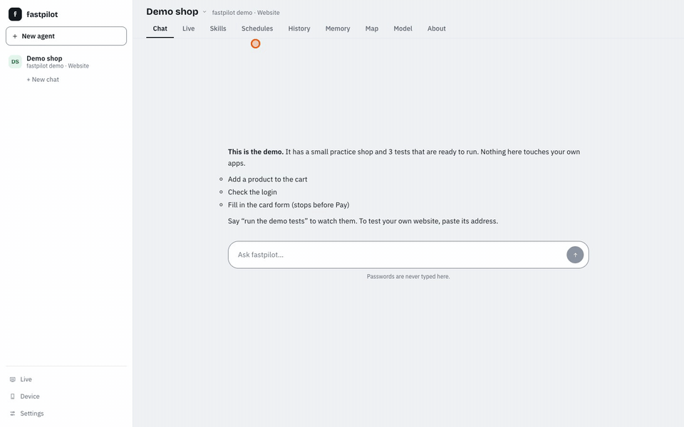
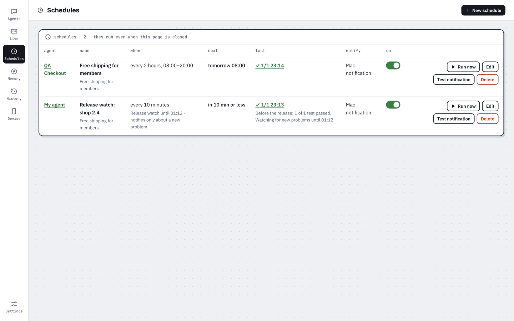

# fastpilot

**Test your web, Android, and iOS apps in plain language, from one dashboard.**
You say what to check; AI runs it on your own computer, shows you every step live, and tells you
what passed and what failed. Free, open source, no cloud. Payment and delete-account buttons are
blocked from the start.



*A 60-second tour, sped up where the AI is thinking. Chat turns one sentence into a test, Live shows each step on web and on an Android emulator (the Pay button is blocked), and a failing test says why.*


## Start in 2 steps

You need a Mac (or Linux), Google Chrome, and [Claude Code](https://claude.com/claude-code) signed in.
No project folder is needed: run it from anywhere.

**1. Install** (once)

```bash
npm install -g fastpilot
```

**2. Open the dashboard** (every time)

```bash
fastpilot
```

Your browser opens the dashboard. Keep the Terminal open while you use it; `Ctrl-C` closes it.

- The first time, paste your app's address and click **Check the login**. fastpilot asks for the
  test account right there, once, in a masked field. It is kept in this Mac's Keychain for that app
  and typed only on that app's own website, never into the chat.
- Your tests, schedules and notes live in `~/fastpilot`, one workspace for all your apps. Switch apps
  at the top left.
- The first `fastpilot` also adds fastpilot to Claude Code for every folder, so Claude Code can run
  your tests too.
- Typed again while the dashboard runs, `fastpilot` opens the same dashboard with a fresh link.
  After an update it offers to restart an older dashboard (it asks first, and only stops its own).
- The link works **once**, for **10 minutes**. If it expired, type `fastpilot` again.
- On the first open the dashboard asks **Remember this browser?** Say yes, and a bookmark of the
  dashboard opens it again without a new link, even after `fastpilot ui` restarts (it keeps its
  port). It stays signed in for 30 days after its last use, at most 90 days, only on this Mac. See
  and forget remembered browsers in Settings › Security.
- The dashboard only works on this computer.
- Open it yourself; do not ask the AI to open it for you.

Everything else happens in the dashboard.

> Just want to look around first? Run `fastpilot demo` instead. It makes a demo folder with demo
> pages and example tests, and opens the dashboard on it.

### Developer mode: tests next to your code (optional)

If you want the tests in your code repository (reviewed in pull requests, run by the GitHub Action),
set fastpilot up inside that repository:

```bash
cd ~/your-project
fastpilot init
```

`init` asks before each change; answer `y`. The dashboard then shows the repository as one more app.
For CI, a password can also come from the environment (`export DEMO_PASS=...`).

> Using the Claude Code plugin (the MCP server and its 24 skills in one step:
> `/plugin marketplace add autobot-lab/fastpilot`, then `/plugin install fastpilot@fastpilot`)? Use **either** the plugin **or** the registration fastpilot
> adds itself, not both: both together start two fastpilot servers. `fastpilot doctor` shows where
> it is registered.

## Guide: your first test in the dashboard

### 1. Check your devices: **Device**
Shows whether Chrome, Android, and iOS are ready, with a ✓ or the reason why not.
- **Install Chrome** and **Set up an emulator** are one-click **Fix** buttons. Each asks you first,
  showing the size and the time it takes.
- **iPhone** testing needs a one-time setup with your Xcode (about 5 minutes).
- Only web? Chrome is enough.


### 2. Pick the AI and store passwords: **Settings**
- **AI model:** pick the provider, then the model. Claude Code is the default. Other providers
  (OpenAI, OpenRouter, Groq, Ollama) also work, and are marked "not tested yet".
- **Secrets:** add the names of passwords your tests need, for example `TEST_PASS`. Tests write them as
  `${TEST_PASS}`, and they always show as `***`. Never type a password in Chat.
- **Limits & permissions:** see the next section, "Safe from the start".

### 3. Make an agent: **Agents › New agent**
An agent is a tester with its own job, devices, instructions, and skills.
- Fill in three things: what it tests, where (Web, Android emulator, iPhone simulator…), and its
  instructions. Click a suggested instruction to add it.
- **Skills** are ready-made test know-how, grouped by technique: boundary values, decision tables,
  regression, safe checkout, and more. Suggested skills are already ticked, each with a reason.
  With Atlassian's MCP server in Claude Code, three Jira skills turn tickets into tests, log a
  failed run as a bug and post results; each write to Jira waits for your OK
  ([setup](docs/guide.md#jira)).
- Or simply describe the agent in one sentence in Chat and click **Create**.

You can have several agents, for example "Checkout" on web and "Login" on Android. Each has its own
**Chat, Live, Schedules, Instructions, Skills, History** and **Agent settings**.

### 4. Ask for a test: **Chat**
Write what you want in plain words:

| You want to | Type in Chat |
|---|---|
| Check something now | *Check that login on https://yourapp.com goes to the Dashboard* |
| Save a test | *Create a test for the checkout flow and save it* |
| Test a field properly | *Test the quantity field properly* (it picks the technique and shows what it covered) |
| Run everything | *Run a regression* (newly failing tests come first) |
| Before a release | *Is staging ready to ship?* (one verdict: SHIP, SHIP WITH FIXES, DO NOT SHIP) |
| Understand a failure | *Why did the checkout test fail?* |

When a test is ready, a card shows its steps: **Save & schedule** or **Save test only**. Nothing is
saved before you click. The picture at the top of this page shows such a card.

### 5. Watch it run: **Live**
Watch every test step by step, on web, Android, and iOS. **Take over** if you need to tap something
yourself, then hand it back to the AI. Several agents can run at the same time; a phone runs one
test at a time and the others wait their turn.


### 6. Run it automatically: **Schedules**
- **Every N hours** (with active hours, for example 08:00–20:00), every day, or every week.
- **Run now** for any schedule.
- **Release watch:** after a release, re-check every few minutes for a few hours and only tell you
  about new problems.
- Get notified by Slack webhook, Mac notification, or GitHub issue when something fails.
- Or just ask in Chat: *"run the checkout tests every 2 hours"*.



### 7. See results: **History** and **Memory**
- **History:** every run and every Chat conversation, with report, screenshots, and video. Delete
  one, several, or all, or let them be deleted after 7, 30, or 90 days.
- **Memory:** how each test is doing (Reliable, Unstable, Failing, Set aside), plus **project notes**
  every agent reads, for example *"Staging is https://staging.yourapp.com"* or *"Login uses a code"*.

## Dashboard map

| Menu | What it's for |
|---|---|
| **Agents** | Your testers: Chat, Live, Schedules, Instructions, Skills, History, Agent settings. Also the skill **Library** |
| **Live** | Every running test, from all agents |
| **Schedules** | All schedules and release watches |
| **Memory** | Test health and project notes |
| **History** | Past runs and conversations |
| **Device** | Chrome, Android, iOS readiness and Fix buttons |
| **Settings** | AI model, Limits & permissions, Secrets, Security (remembered browsers) |

## Safe from the start

- Buttons like **pay, buy, checkout, transfer, delete account** are always blocked.
- Plain **delete/remove** buttons must be confirmed first.
- The AI can make the rules stricter, never looser. To loosen one, **you** approve it: Chat shows a red
  card that quotes what you asked, and allowing **Pay** also needs you to type "Pay". Text on a tested
  page can never ask for a change.
- Every change is kept in `~/.fastpilot/audit.jsonl`.

Want to test a checkout for real? Ask in Chat: *"Allow the Pay button for this project"*, or open
**Settings › Limits & permissions**.

These limits protect you from what a tested page tells the AI. They are not a lock against programs
on your own computer: anything that runs as you can edit `~/.fastpilot/config.toml`.

## Control everything from Chat

What a dashboard page does, you can also ask for in Chat (the dashboard's, or Claude Code's), or
type in a terminal. All three use the same apps, tests, schedules and passwords.

| What | In a terminal |
|---|---|
| Your apps | `fastpilot app list`, `app add https://your-site` (or `app add com.shop.app --android`), `app switch NAME`, `app remove NAME` |
| One-click schedules | `fastpilot schedule add` (every 2 hours, 8–20), `--nightly` or `--before-release`; `schedule pause ID`, `resume ID`, `remove ID` |
| Test passwords | `fastpilot secret set TEST_PASSWORD` (typed hidden, or piped in; never on the command line), `secret list`, `secret remove NAME` |

Removing an app or a schedule asks first. A password is kept for its app in this Mac's Keychain
and typed only on that app's own website, wherever you set it from.

## Prefer the terminal?

Everything also works from Claude Code. Open Claude in any folder (`claude`) and say it in
plain words, for example *"fastpilot, run a regression"* or *"fastpilot, test the login page"*.
Results, schedules, and history show up in the dashboard too.

In GitHub Actions, use [`autobot-lab/fastpilot-action@v1`](https://github.com/autobot-lab/fastpilot-action):
it runs your tests on every pull request and adds the JUnit and HTML reports.

## If you get stuck

Open **Device** in the dashboard, or run:

```bash
fastpilot doctor
```

| Problem | Try |
|---|---|
| The dashboard link doesn't work | It works once, for 10 minutes. Type `fastpilot` again for a fresh one. Choose "Remember this browser" so a bookmark works next time |
| Chrome or Android isn't ready | **Device** › Fix buttons, or `fastpilot setup web` / `fastpilot setup android` |
| iPhone isn't ready | `fastpilot setup ios` (once, with Xcode) |
| fastpilot doesn't show up in Claude | Run `fastpilot doctor`, then `fastpilot init --global` |
| A test stops with "Blocked by limits" | That's on purpose. See **Settings › Limits & permissions** |
| A test stops with "setup needed: the test needs the password …" | In Chat, click **Save and run** on the card and type it once (or Settings › Secrets). In CI: `export FASTPILOT_VARS=TEST_PASS TEST_PASS=...` |
| A test stops with "a password of this app is only used on its own website" | On purpose: a saved password is typed and sent only to the app's own site. Check the app's website in Settings › Your apps |

## Learn more

- **[Full guide](docs/guide.md)**: writing tests by hand, all settings, Android, iOS, Claude Desktop,
  devices on another computer, known limits
- [Physical phones](docs/real-devices.md)
- [Release notes](https://github.com/autobot-lab/fastpilot/releases)

License: [Apache-2.0](LICENSE)
